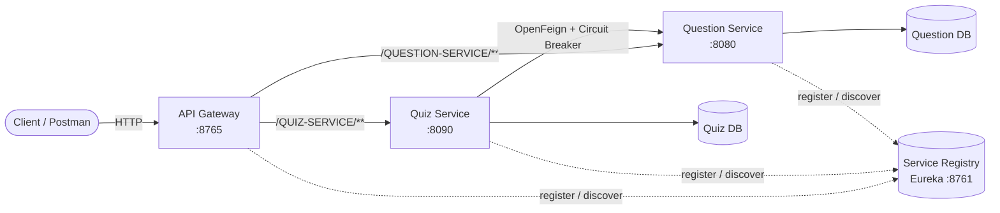
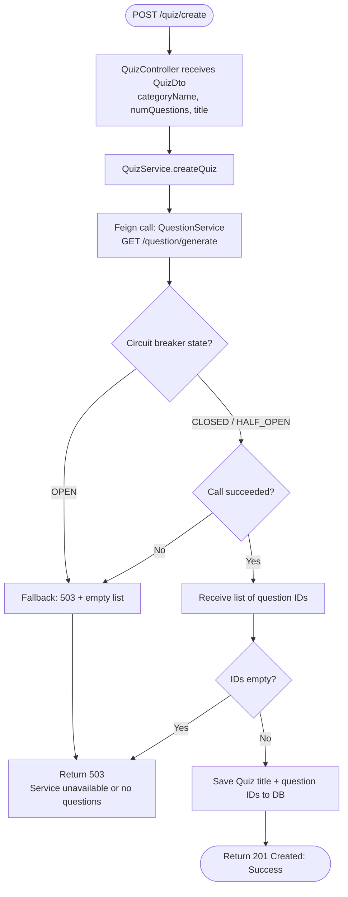
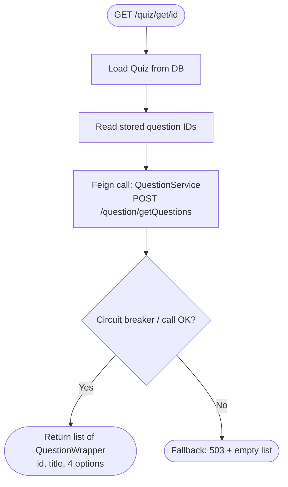
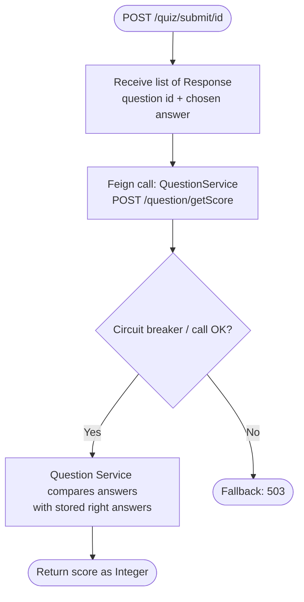
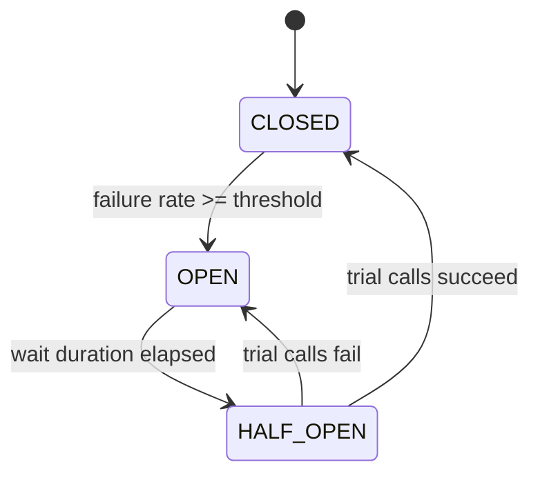

# Quiz Application (Microservices)

A quiz application built with **Spring Boot microservices**. Users can create a quiz from a category, fetch its questions, and submit answers to get a score. Services discover each other through **Eureka**, are exposed through an **API Gateway**, and communicate using **OpenFeign** protected by a **Resilience4j circuit breaker**.

## Architecture



| Component | Port | Responsibility |
|---|---|---|
| Service Registry (Eureka) | 8761 | Service discovery |
| API Gateway | 8765 | Single entry point, routes by service name |
| Question Service | 8080 | Stores questions, picks random questions, calculates score |
| Quiz Service | 8090 | Stores quizzes (title and question IDs), orchestrates calls to Question Service |

> Ports are the defaults used during development. Adjust them to match your `application.properties`.

## Tech Stack

- Java, Spring Boot
- Spring Cloud Netflix Eureka (service discovery)
- Spring Cloud Gateway (routing)
- Spring Cloud OpenFeign (inter-service calls)
- Resilience4j (circuit breaker, via Spring Cloud Circuit Breaker)
- Spring Data JPA with a relational database
- Spring Boot Actuator (health and circuit breaker monitoring)

## Application Flow

### 1. Create a quiz



### 2. Get quiz questions



### 3. Submit answers and get score



## Circuit Breaker

The Quiz Service wraps every Feign call to the Question Service in a circuit breaker so that a failing Question Service does not take Quiz Service down with it.



| State | Behaviour |
|---|---|
| CLOSED | Calls go through normally. Failures are recorded. |
| OPEN | Calls are rejected immediately and the fallback runs. |
| HALF_OPEN | A few trial calls are allowed to check whether the service has recovered. |

### Configuration (Quiz Service `application.properties`)

```properties
spring.cloud.openfeign.circuitbreaker.enabled=true

spring.cloud.openfeign.client.config.default.connect-timeout=2000
spring.cloud.openfeign.client.config.default.read-timeout=3000

resilience4j.circuitbreaker.configs.default.sliding-window-size=10
resilience4j.circuitbreaker.configs.default.minimum-number-of-calls=5
resilience4j.circuitbreaker.configs.default.failure-rate-threshold=50
resilience4j.circuitbreaker.configs.default.wait-duration-in-open-state=10s
resilience4j.circuitbreaker.configs.default.permitted-number-of-calls-in-half-open-state=3
resilience4j.timelimiter.configs.default.timeout-duration=5s

management.endpoints.web.exposure.include=health,circuitbreakers,circuitbreakerevents
management.health.circuitbreakers.enabled=true
```

### Key classes

- `QuizInterface`: Feign client with `@FeignClient(name = "QUESTION-SERVICE", fallback = QuizInterfaceFallback.class)`
- `QuizInterfaceFallback`: `@Component` that returns a `503` response when the Question Service is unreachable
- `QuizService.createQuiz`: checks for a `503` or empty response before saving, so an empty quiz is never stored

## API Reference

All requests go through the gateway: `http://localhost:8765/<SERVICE-NAME>/...`

### Quiz Service

| Method | Endpoint | Body | Description |
|---|---|---|---|
| POST | `/QUIZ-SERVICE/quiz/create` | `{"categoryName":"Java","numQuestions":2,"title":"JavaQuiz"}` | Create a quiz |
| GET | `/QUIZ-SERVICE/quiz/get/{id}` | none | Get the questions of a quiz |
| POST | `/QUIZ-SERVICE/quiz/submit/{id}` | `[{"id":4,"response":"throw"}]` | Submit answers and get the score |

### Question Service (called by Quiz Service via Feign)

| Method | Endpoint | Description |
|---|---|---|
| GET | `/question/generate?categoryName=&numQuestions=` | Return random question IDs for a category |
| POST | `/question/getQuestions` | Return question details for a list of IDs |
| POST | `/question/getScore` | Calculate the score from a list of responses |

> The Question Service may expose extra endpoints (for example add or list questions). Document them here as needed.

## Running the Application

Start the services in this order:

1. **Service Registry** (Eureka) on `8761`
2. **Question Service**
3. **Quiz Service**
4. **API Gateway**

Open the Eureka dashboard at `http://localhost:8761` and confirm that `QUESTION-SERVICE`, `QUIZ-SERVICE`, and `API-GATEWAY` are registered before sending requests.

## Testing the Endpoints

```bash
# Create a quiz
curl -X POST http://localhost:8765/QUIZ-SERVICE/quiz/create \
  -H "Content-Type: application/json" \
  -d '{"categoryName":"Java","numQuestions":2,"title":"JavaQuiz"}'

# Get quiz questions
curl http://localhost:8765/QUIZ-SERVICE/quiz/get/1

# Submit answers (use the option text as the response)
curl -X POST http://localhost:8765/QUIZ-SERVICE/quiz/submit/1 \
  -H "Content-Type: application/json" \
  -d '[{"id":4,"response":"throw"},{"id":3,"response":"false"}]'
```

### Testing the circuit breaker

1. Stop the Question Service.
2. Call `POST /quiz/create` five or more times. Each call returns `503`.
3. Check the breaker state:
   ```bash
   curl http://localhost:8090/actuator/circuitbreakers
   ```
   The state should be `OPEN`, with `notPermittedCalls` increasing.
4. Start the Question Service again and wait for it to register in Eureka.
5. Wait for the open duration (10s), then call `create` 3 times. The state returns to `CLOSED`.

## Troubleshooting

| Problem | Likely cause |
|---|---|
| `500` instead of `503` when Question Service is down | Fallback not wired: check `spring.cloud.openfeign.circuitbreaker.enabled=true`, the Resilience4j starter dependency, and the `fallback` attribute on `@FeignClient` |
| `405 Method Not Allowed` on `/quiz/submit/{id}` | Using `GET` instead of `POST` |
| `503` through the gateway right after startup | Service not yet registered in Eureka (wait about 30 seconds) |
| Score is always 0 | The `response` values do not match the stored right answers (use the option text) |
| Quiz returns more questions than requested | Quiz was created earlier with a larger `numQuestions`, or the `generate` query ignores the limit |

## Possible Improvements

- Return `404` for an unknown quiz ID instead of calling `findById(id).get()`
- Distinguish "service down" (`503`) from "no questions in category" (`404`)
- Add authentication at the gateway
- Add unit and integration tests for the fallback behaviour